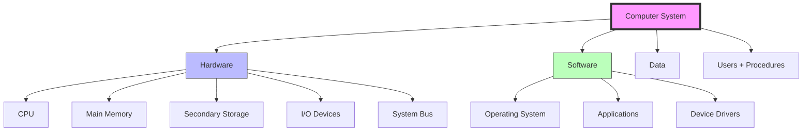

2026-08-07 13:24

Status: #Teen 

Tags: [[OS]] [[CPU]] 

# Operating System Intro

##### what is a computer system?
A computer system is an integrated collection of hardware and software components that work together to process data and produce meaningful output

it has four fundamental systems

~~~
┌─────────────────────────────────────────────┐
│           COMPUTER SYSTEM                   │
├─────────────┬─────────────┬─────────────────┤
│   HARDWARE  │   SOFTWARE  │      DATA       │
│             │             │                 │
│ • CPU       │ • OS        │ • Files         │
│ • Memory    │ • Apps      │ • Databases     │
│ • Storage   │ • Drivers   │ • User Input    │
│ • I/O Dev   │ • Utilities │                 │
│ • Bus       │             │                 │
└─────────────┴─────────────┴─────────────────┘
~~~

# References